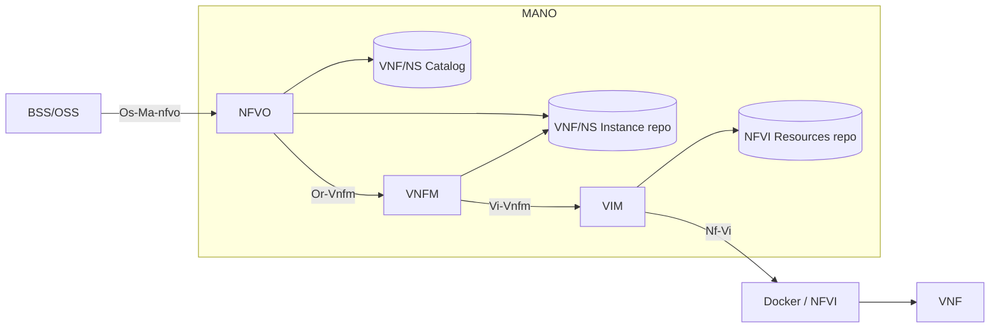
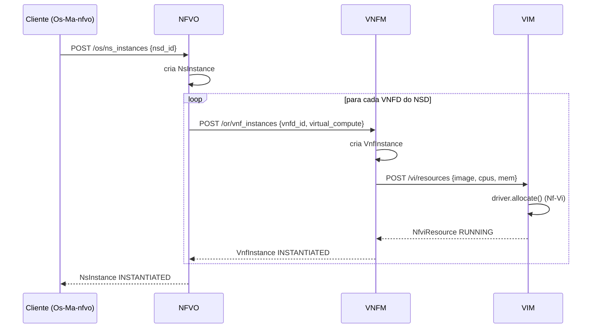

# Arquitetura ETSI NFV-MANO

Este documento descreve a arquitetura padrão da ETSI para o NFV-MANO e como
cada bloco foi mapeado para o código deste repositório. O objetivo do
protótipo base é o **NFV-MANO sem tolerância a falhas**; a evolução para uma
arquitetura tolerante a falhas está descrita em
[`requisitos-tolerancia-falhas.md`](./requisitos-tolerancia-falhas.md).

## 1. Visão geral do framework NFV (ETSI)

O framework NFV da ETSI (GS NFV 002) é composto por três domínios:

- **VNF** — Virtualised Network Function: a função de rede virtualizada.
- **NFVI** — Network Functions Virtualisation Infrastructure: hardware,
  virtualização e rede onde as VNFs executam.
- **NFV-MANO** — Management and Orchestration: gerencia e orquestra NFVI e
  VNFs.

O NFV-MANO é o foco deste projeto e contém:

| Bloco / repositório | Responsabilidade |
| --- | --- |
| **NFVO** (NFV Orchestrator) | Orquestração de recursos entre VIMs e gestão do ciclo de vida de Network Services (NS). |
| **VNFM** (VNF Manager) | Gestão do ciclo de vida de instâncias de VNF. |
| **VIM** (Virtualised Infrastructure Manager) | Controle dos recursos de compute, storage e rede da NFVI. |
| **NS Catalog** | Descritores de Network Service (NSD). |
| **VNF Catalog** | Descritores de VNF (VNFD). |
| **NS/VNF Instance repository** | Estado das instâncias em execução. |
| **NFVI Resources repository** | Recursos de NFVI alocados e VIMs registrados. |

## 2. Reference points e mapeamento para o código

A ETSI define *reference points* (pontos de referência) entre os blocos. Neste
protótipo eles são APIs REST (FastAPI):

| Reference point | Entre | Implementação neste projeto |
| --- | --- | --- |
| `Os-Ma-nfvo` | OSS/BSS ↔ NFVO | `nfvo.py` (`/os/...`) |
| `Or-Vnfm` | NFVO ↔ VNFM | `vnfm.py` (`/or/...`) + `nfvo.py` (`VnfmClient`) |
| `Vi-Vnfm` | VNFM ↔ VIM | `vim.py` (`/vi/...`) + `vnfm.py` (`VimClient`) |
| `Nf-Vi` | VIM ↔ NFVI | `vim.py` (`MockDriver`, `DockerDriver`) |
| `Or-Vi` | NFVO ↔ VIM | **Fora do escopo** do protótipo base (orquestração de recursos entre múltiplos VIMs). |
| `Ve-Vnfm-em` | EM ↔ VNFM | Visão somente leitura em `vnfm.py` (`/ve/...`). |
| `Ve-Vnfm-vnf` | VNFM ↔ VNF | **Fora do escopo** (interação direta com a VNF). |
| `Vn-Nf` | VNF ↔ NFVI | Fornecido pela plataforma de virtualização (Docker). |

## 3. Diagrama de blocos



## 4. Organização do código

```
src/nfv_mano/
  config.py         # settings (pydantic-settings), portas e backend
  common.py         # ids, logging, exceções e mapeamento de erro -> HTTP
  models.py         # modelos ETSI e enums de LCM
  repositories.py   # interface Repository[T] + backends memory/file
  nfvo.py           # NFVO: catálogos, NS LCM e cliente Or-Vnfm
  vnfm.py           # VNFM: VNF LCM e cliente Vi-Vnfm
  vim.py            # VIM: Vi-Vnfm + drivers Nf-Vi (mock/docker)
  cli.py            # comandos serve e demo
```

Cada bloco do MANO fica em um único arquivo (como nas implementações de
referência), separando apenas o que é transversal: modelos, repositórios,
configuração e utilitários.

## 5. Fluxo de instanciação de um Network Service



## 6. Gestão de ciclo de vida (LCM)

Os estados seguem a nomenclatura da ETSI para que a API possa evoluir para os
schemas SOL sem renomear campos:

- `InstantiationState`: `NOT_INSTANTIATED`, `INSTANTIATED`.
- `LcmOperationState`: `STARTING`, `PROCESSING`, `COMPLETED`, `FAILED_TEMP`,
  `FAILED`, `ROLLING_BACK`, `ROLLING_BACK_FAILED` (`is_terminal`, `is_success`).
- `ResourceState`: estado de um recurso de NFVI no VIM.

Referências: GS NFV-SOL 003 (VNF LCM) e GS NFV-SOL 005 (NS LCM).

## 7. Configuração

Todas as opções usam o prefixo `NFV_MANO_` (ou um arquivo `.env`), definidas em
`config.py`:

| Variável | Padrão | Descrição |
| --- | --- | --- |
| `NFV_MANO_NFVO_HOST` / `_PORT` | `127.0.0.1` / `9002` | Bind do NFVO. |
| `NFV_MANO_VNFM_HOST` / `_PORT` | `127.0.0.1` / `9001` | Bind do VNFM. |
| `NFV_MANO_VIM_HOST` / `_PORT` | `127.0.0.1` / `9000` | Bind do VIM. |
| `NFV_MANO_REPOSITORY_BACKEND` | `memory` | `memory` ou `file`. |
| `NFV_MANO_DATA_DIR` | `data` | Diretório do backend de arquivos. |
| `NFV_MANO_VIM_DRIVER` | `mock` | `mock` ou `docker`. |
| `NFV_MANO_VNFM_ID` | `vnfm-1` | Identidade do VNFM nas instâncias. |
